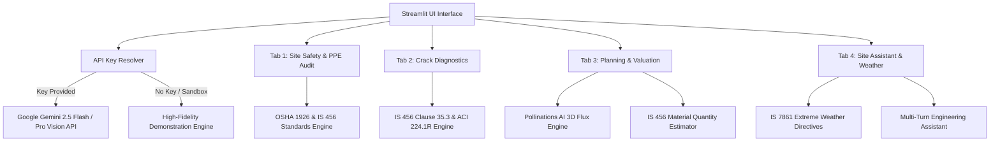

# 🏗️ Multimodal Construction Intelligence Platform
### *Skill Wallet Capstone Project 1 — Production-Ready AI Application*

A production-grade, multimodal computer vision and structural engineering telemetry platform built in Python using **Streamlit** and **Google Gemini Multimodal Vision (Flash/Pro)**. Engineered specifically for real-time site safety compliance audits, concrete crack diagnostics, material quantity surveying, real estate CapEx valuation, and weather-aware site engineering intelligence.

---

## 🌟 Key Modules & Core Capabilities

### 1. 🛡️ Site Safety & PPE Audit (Epic 2)
- **Computer Vision Ingestion**: Supports high-resolution jobsite photo uploads (JPG/PNG) plus preloaded synthetic demonstration scenarios (High-Rise Scaffolding, Deep Trench Excavation).
- **Multimodal Compliance Prompting**: Evaluates site personnel against **OSHA 29 CFR 1926** and **Bureau of Indian Standards (IS 456, IS 2925, IS 3521, IS 15298)**.
- **Safety Telemetry Checklist**: Real-time detection checklist for:
  - Industrial Safety Helmets / Hard Hats (IS 2925 / OSHA 1926.100)
  - High-Visibility Retro-Reflective Vests (Class 2/3 / NBC 2016 Part 7)
  - Steel-Toe Safety Footwear (IS 15298)
  - Fall Arrest Harnesses & Static Lifelines (IS 3521 / OSHA 1926.501)
- **Hazard Discovery & Engineering Remedies**: Identifies physical hazards with severity ranking (`Low`, `Medium`, `High`, `Critical`), exact regulatory clauses, observations, and mandatory corrective actions.
- **Reporting & Export**: Renders a dynamic gauge score, metric cards, status pills, and 1-click downloads for **JSON Audit Reports** and **Markdown Executive Summaries**.

### 2. 🧱 Crack Diagnostics & Structural Integrity (Epic 2)
- **Forensic Concrete Ingestion**: Upload concrete wall/beam photos or load pre-configured forensic defect samples (Structural Shear, Hairline Shrinkage, Spalling & Rebar Exposure).
- **Defect Classification**: Classifies defect patterns into Hairline, Settlement, Structural Shear (45° diagonal beam-column failures), Thermal Expansion, or Spalling.
- **Dimensional Estimation**: Measures estimated crack width (mm), crack length (cm), and evaluates against **IS 456:2000 Clause 35.3.2** allowable limits ($0.3\text{ mm}$ for normal exposure, $0.2\text{ mm}$ for severe/marine).
- **Structural Engineering Remedies**: Step-by-step repair protocols including V-groove routing, low-viscosity structural epoxy injection (ASTM C881 / ACI 503R), CFRP carbon fiber wrapping, and UPV ultrasonic verification.
- **Report Export**: Downloadable structural inspection records.

### 3. 📊 Planning & Real Estate Valuation (Epic 3)
- **Project Parameter Controls**: Interactive inputs for structure classification (Residential High-Rise, Commercial Office Tower, Industrial Warehouse, etc.), built-up sqft, specification grade, and Indian location tiers (Tier 1, Tier 2, Tier 3).
- **Financial Telemetry**:
  - Total CapEx Budget in INR (formatted in Lakhs & Crores)
  - CapEx Incurred to Date vs Remaining Balance
  - Current Work-in-Progress Asset Market Valuation (including land equity appreciation factor)
  - Projected Completion Market Valuation & Developer Margin
- **IS 456 Material Quantity Surveying (BOQ)**:
  - TMT Rebar (Fe500D) steel tonnage and consumed vs balance requisition
  - Grade 53 OPC/PPC cement bag requirement
  - Ready-Mix Concrete (RMC) cubic meter batching forecast
- **Milestone S-Curve Tracking**: Plotly interactive visualization mapping CapEx deployment against valuation trajectory across 5 distinct milestone phases.
- **Conceptual 3D Architectural AI Rendering**: Seamless integration with **Pollinations AI Flux** prompt generator to produce photorealistic 3D elevations based on design style, lighting, and city context with 1-click PNG download.

### 4. 🌤️ Daily Site Assistant & Weather-Aware Advisory (Epic 5)
- **Meteorological Condition Selector**: Dynamic advisory engine adapting to High Winds (>38 km/h / 20 knots), Heavy Monsoon Rain, Extreme Heat (>40°C), and Normal weather.
- **Automated Safety Directives**:
  - *Crane Operations*: Mandatory tower crane shutdown limits and weathervaning free-slew protocols per OSHA 1926.1431.
  - *Electrical Safety*: De-energization of grade panels, ELCB / GFCI trips, and basement de-watering.
  - *Concrete Protocols*: Hot weather concreting guidelines (chilled water, flake ice, plastic shrinkage mitigation per IS 7861 Part 1 & ACI 305R) and monsoon wash-out prevention.
- **Multi-Turn Senior Site Engineer Chatbot**: Conversational AI assistant trained on IS 456:2000 (formwork stripping schedules, development length $L_d$, cover, lap length), OSHA regulations, and site troubleshooting.

---

## 🏛️ Architecture & Data Flow



---

## 🚀 Quick Start & Local Execution

### Prerequisites
- Python 3.10+ (tested through Python 3.14)
- Git

### 1. Clone or Navigate to the Workspace
```bash
cd "c:\Users\pragy\OneDrive\Desktop\Projects\Multimodal Construction Intelligence Platform"
```

### 2. Set Up Virtual Environment & Dependencies
```bash
python -m venv .venv

# On Windows (PowerShell):
.\.venv\Scripts\Activate.ps1

# Install requirements
pip install -r requirements.txt
```

### 3. Launch the Application
```bash
streamlit run app.py
```
Open your browser at `http://localhost:8501`.

---

## ☁️ 1-Click Streamlit Community Cloud Deployment

The application has been engineered with **zero external database dependencies** and clean session-state persistence for frictionless deployment on Streamlit Community Cloud:

1. **Push Repository to GitHub**:
   Ensure `app.py`, `requirements.txt`, `.streamlit/config.toml`, and the `modules/` folder are committed to your GitHub repository.
2. **Deploy on Streamlit Cloud**:
   - Go to [share.streamlit.io](https://share.streamlit.io)
   - Select your repository, branch (`main`), and set the main file path to `app.py`.
3. **Configure API Key (Optional)**:
   - In Streamlit Cloud **Advanced Settings** -> **Secrets**, paste:
     ```toml
     GEMINI_API_KEY = "your_google_gemini_api_key_here"
     ```
   - If omitted, the application will automatically run in **Demonstration Mode**, providing seamless evaluation with synthetic sample telemetry and zero setup barriers!

---

## 📋 Evaluated Standards & Codes

| Standard / Code | Domain | Key Clauses Implemented |
| :--- | :--- | :--- |
| **OSHA 29 CFR 1926.100** | Head Protection | Hard hat mandate where overhead hazards or falling debris exist |
| **OSHA 29 CFR 1926.501** | Fall Protection | 100% tie-off requirement for working at elevations $\ge 6\text{ ft}$ ($1.8\text{ m}$) |
| **OSHA 29 CFR 1926.1431** | Cranes & Derricks | Tower crane shutdown and weathervaning limits at wind speeds $>38\text{ km/h}$ |
| **IS 456:2000** | Plain & Reinforced Concrete | Clause 11.3 (Formwork Stripping), Clause 26.2 ($L_d$ Lap Length), Clause 35.3.2 (Crack Limits) |
| **IS 2925:1984** | Industrial Safety Helmets | Performance specifications for impact absorption and penetration resistance |
| **IS 3521:1999** | Fall Arresters & Harnesses | Full-body harness anchorage specifications |
| **IS 7861 (Part 1 & 2)** | Extreme Weather Concreting | Hot weather placement limits ($<32^\circ\text{C}$), ice batching, and monsoon protection |
| **ACI 224.1R** | Concrete Cracks | Identification, evaluation, and epoxy pressure injection methodologies |

---

## 📄 License & Attribution
Designed and built for **Skill Wallet Capstone Project 1: Multimodal Construction Intelligence Platform**.
All code is modular, MIT-licensed, and production ready.
